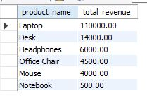
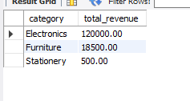
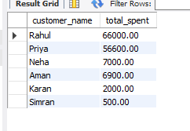
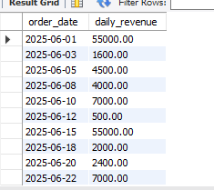

# Retail Sales Analysis Using SQL

## Project Overview

This project analyzes retail sales data using SQL and MySQL Workbench to identify top-performing products, revenue by category, and customer purchasing patterns.

The project uses sample data across three related tables: customers, products, and orders.

## Objectives

- Identify the products and categories that bring the revenue in Retail Sales Analysis.

- Calculate the total spending by each customer in Retail Sales Analysis.

- Analyse revenue across order dates in Retail Sales Analysis.

- Practise SQL joins, aggregations, CTEs and window functions in Retail Sales Analysis.

## Tools Used

- MySQL

- MySQL Workbench

## Dataset

The Retail Sales Analysis project contains three tables:

- **customers:** customer details and signup dates

- **products:** product names, categories and prices

- **orders:** customer orders, quantities and dates

The sample dataset has 6 customers, 6 products and 10 orders. I made it for learning and for my portfolio.

## SQL Skills Demonstrated

- INNER JOIN and LEFT JOIN in SQL

- GROUP BY. Having in SQL

- Aggregate functions such as SUM() in SQL

- Calculated revenue using quantity × price in SQL

- Common Table Expressions (CTEs) in SQL

- DENSE_RANK() and LAG() in SQL

- NULL handling and sorting in SQL

## Key Findings

- Laptop generated ₹1,10,000 in revenue.

- Electronics generated ₹1,20,000 in revenue.

- Rahul was the highest-spending customer, with ₹66,000 in spending.

- The highest-revenue order date was 1 June 2025, with ₹55,000.

## Limitations

This dataset is small and illustrative. The results show SQL analysis techniques. They should not be applied to a real retail business.

## How to Run

1. Open MySQL Workbench and connect to your MySQL server.
2. Run `Retail_Sales_Analysis_setup.sql` to create the database, tables, and sample data.
3. Open `Retail_Sales_Analysis_queries.sql`.
4. Execute the analysis queries to reproduce the results.

## Project Screenshots

### 1. Product Revenue Analysis

### 2. Category Revenue Analysis

### 3. Customer Spending Analysis

### 4. Daily Revenue Analysis

